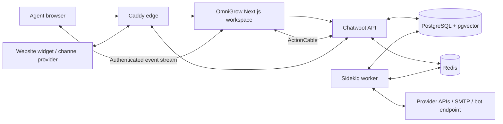

# Architecture and implemented scope

Next.js 16.4.0 with React 19.3.0 serves the branded workspace. Chatwoot 4.18.0 is an actual pinned service (the `v4.18.0` tag digest), supplying persistence, tenancy, channel integrations, widget, reports, automation, and delivery workers. PostgreSQL 16 with pgvector and Redis 7.4 retain state. Core container images are pinned by digest. The production overlay adds a non-root standalone Next.js image, Caddy HTTPS termination, memory limits, bounded container logs, and `no-new-privileges` on every service.

The browser signs in with the same credentials as the engine. DeviseTokenAuth session credentials live inside an encrypted, HttpOnly, SameSite cookie; browser code does not receive the user's permanent API token. A session ends eight hours after the last request that carried it and twenty-four hours after sign-in regardless; route handlers renew the idle anchor at most every fifteen minutes, so an open tab keeps a session alive and everyone re-authenticates daily. Login uses the native password/MFA endpoints, including recovery codes. MFA challenge data remains sealed in a short-lived cookie. Logout revokes the upstream login session and destroys the cookie even when the engine is unreachable. Users who belong to many workspaces keep only workspace ids and roles in the cookie; names come from `/api/auth/me`.

Workspace requests use a fixed engine base URL and a path allowlist. Account IDs come from the validated session; clients cannot choose an arbitrary tenant or upstream URL. Writes require the configured exact Origin. Administrative writes reload current membership/role, and the engine enforces its own resource authorization. Endpoints the engine will call back (account webhooks, agent bots, API-channel reply webhooks) must be HTTPS. Responses redact provider secrets and upstream error details. Behind the production proxy the app forwards the real client address (`X-Forwarded-For` from Caddy's `X-Real-IP`) on every engine request, so the engine's rate limits, audit trail and login throttle apply per visitor rather than to the app container as a whole, and it forwards Caddy's request id (`X-Request-ID`) so one id correlates a browser error, the app log line and the engine log line. The same id is returned to the browser and shown as a reference on error notices.

Realtime subscriptions keep the native user pubsub token on the server. Because that token receives events across the user’s memberships, the relay filters every event by the selected workspace’s account ID (every engine broadcast carries it). An authenticated SSE relay sends events to the browser; the dashboard falls back to polling when disconnected. Streams are grouped per sign-in: one engine authorization check every 20 seconds covers all tabs of that sign-in, at most six streams are open per sign-in (`REALTIME_MAX_STREAMS`), and logout or account switching closes the group immediately on the serving app instance. Revocation on a different instance is bounded by that interval plus the upstream timeout (up to 40 seconds). On SIGTERM the app closes its streams first so browsers reconnect to the replacement instance; the production overlay allows 20 seconds for in-flight requests. The native engine's separate administration interface retains its upstream realtime-session behavior.

Page responses carry a nonce-based Content Security Policy built per request (`src/lib/csp.ts`). It starts in report-only mode; violations are logged at `/api/csp-report` as `content security policy violation` lines, and `CSP_MODE=enforce` switches to blocking once a deployment is clean. Health probes use the engine's rate-limit-exempt `/health` route, and Caddy exposes `/api/health` only to the configured monitoring address.

## Feature boundary

| Area | OmniGrow workspace | Additional native administration or external dependency |
| --- | --- | --- |
| Inbox | Queues, filters/search, pagination, history, public replies, private notes, attachments, assignment with a conflict check, priority, labels, resolution/reopen, pending-bot handoff, saved replies, separate persistent reply/note drafts, mobile detail controls | Provider delivery depends on channel authorization and message-window rules |
| Website | Real SDK widget, embedding snippet, demo, agent/customer messaging | Native iframe isolation; Safari-specific cross-site persistence not validated |
| Channels | Website, API, Telegram, WhatsApp Cloud (with Meta app secret for signed webhooks), Twilio SMS (signature-checked callbacks), LINE, IMAP/SMTP email forms; Facebook authorization; native Instagram authorization | Public HTTPS callbacks, provider app approval, credentials, mailbox capabilities |
| Contacts | Search, create/edit, linked conversation history, current-page JSON export | Full account export/import and segmentation use native tooling |
| Reports | Actual account summaries, response/resolution times, daily activity (administrators; the engine limits reports to that role) | Advanced/custom reports and license-gated analytics use native tooling |
| Automation | Saved replies, welcome-message rule, activate/delete, bot endpoint registration and inbox assignment | Complex routing/conditions and bot credential administration use native tooling; Tiledesk needs a compatible adapter |
| Team/settings | Workspace switch, agent invitations, inbox membership, webhook registration/deletion | SMTP is needed for invitations; advanced profile, workspace and routing settings use native tooling |

OmniGrow does not implement a separate visual bot designer, RAG training pipeline, newsletter platform, product tours, billing system, or WebRTC calling stack. Google/SAML and advanced RBAC are native-engine capabilities subject to their own configuration and licensing; the branded login supports password and MFA. Account scoping is enforced by application/native-engine queries, not a newly introduced PostgreSQL RLS scheme. The native engine UI and API remain reachable on the messaging hostname with the same credentials, so the workspace allowlist is a product boundary; authorization is the engine's.

The research document is a broad product and engineering reference. Its proposed architectures and numerical claims are not accepted as measured properties of this implementation. See VALIDATION.md for tested behavior and remaining gaps.

## Failure behavior

API calls have bounded timeouts and show recoverable errors while preserving the agent's draft. When a send fails with a gateway error or timeout, the composer re-reads the thread before asking for a resend, so a reply the engine already stored is not delivered twice. SWR refreshes after actual mutations; report errors are not displayed as zero activity. Outgoing messages show native delivery status and expose retry when the engine supports it. Sidekiq separates delivery from foreground requests, but synchronous database writes can still wait on locks. Ordinary account webhooks are signed; their native dispatch failures are logged rather than automatically retried. Consumers need their own idempotency and monitoring. The app writes single-line JSON logs (`service: omnigrow-app`) with the request id, route and error name, never request bodies or credentials; the engine runs with `LOGRAGE_ENABLED` for structured request logs tagged with the same id.

## Local runtime

`npm run local` initializes services and runs the frontend in the foreground. Docker VFS automatically selects `compose.compact.yaml`, supervising Rails and Sidekiq together to avoid duplicate multi-gigabyte filesystem copies. If either process exits, the container restarts; health checks require the worker process and Rails API. Both layouts allow 45 seconds for graceful shutdown. Production always uses separate workers. Maintenance archives use a small container mounted only to attachment storage, and interrupted-restore markers block setup, service startup, and snapshots. `npm run local:status` checks each required container rather than treating an empty Compose listing as success. Setup promotes the installation owner to engine super admin (`OG_SUPER_ADMIN=0` opts out) and appends hardening defaults to the engine environment when they are absent: telemetry off, a 20 MiB file limit, with proxy buffers allowing multipart framing, structured request logs.

Draft text and attachment names are scoped by user, workspace, conversation, and public/private mode in same-tab session storage with an eight-hour age limit. File objects stay in memory across client navigation and must be reselected after a full reload. Logout clears drafts; unavailable browser storage limits persistence to memory. Retained message pages merge with new events without dropping the middle of loaded history. Incoming messages are marked read when the focused, visible conversation is at its latest messages.
