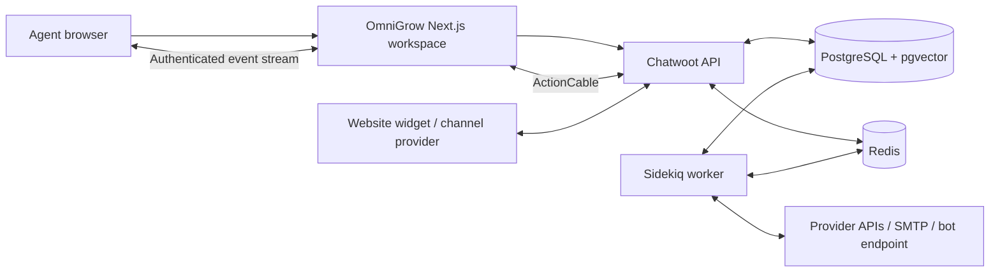

# Architecture and implemented scope

Next.js 16.4.0 with React 19.3.0 serves the branded workspace. Chatwoot 4.18.0 is an actual pinned service, supplying persistence, tenancy, channel integrations, widget, reports, automation, and delivery workers. PostgreSQL 16 with pgvector and Redis 7.4 retain state. Core container images are pinned by digest. The production overlay adds a non-root standalone Next.js image and Caddy HTTPS termination.

The browser signs in with the same credentials as the engine. DeviseTokenAuth session credentials live inside an encrypted, HttpOnly, SameSite cookie with an eight-hour maximum; browser code does not receive the user's permanent API token. Login uses the native password/MFA endpoints, including recovery codes. MFA challenge data remains sealed in a short-lived cookie. Logout revokes the upstream login session.

Workspace requests use a fixed engine base URL and a path allowlist. Account IDs come from the validated session; clients cannot choose an arbitrary tenant or upstream URL. Writes require the configured exact Origin. Administrative writes reload current membership/role, and the engine enforces its own resource authorization. Responses redact provider secrets and upstream error details. Realtime subscriptions keep the native user pubsub token on the server. Because that token receives events across the user’s memberships, the relay filters every event by the selected workspace’s account ID. An authenticated SSE relay sends events to the browser; the dashboard falls back to polling when disconnected. Logout and account switching close streams immediately on the serving app instance. Each stream checks native authorization and membership every 20 seconds; revocation on a different instance is bounded by that interval plus the upstream timeout (up to 40 seconds). The native engine's separate administration interface retains its upstream realtime-session behavior.

## Feature boundary

| Area | OmniGrow workspace | Additional native administration or external dependency |
| --- | --- | --- |
| Inbox | Queues, filters/search, pagination, history, public replies, private notes, attachments, assignment, priority, labels, resolution/reopen, pending-bot handoff, saved replies, separate persistent reply/note drafts, mobile detail controls | Provider delivery depends on channel authorization and message-window rules |
| Website | Real SDK widget, embedding snippet, demo, agent/customer messaging | Native iframe isolation; Safari-specific cross-site persistence not validated |
| Channels | Website, API, Telegram, WhatsApp Cloud, Twilio SMS, LINE, IMAP/SMTP email forms; Facebook authorization; native Instagram authorization | Public HTTPS callbacks, provider app approval, credentials, mailbox capabilities |
| Contacts | Search, create/edit, linked conversation history, current-page JSON export | Full account export/import and segmentation use native tooling |
| Reports | Actual account summaries, response/resolution times, daily activity | Advanced/custom reports and license-gated analytics use native tooling |
| Automation | Saved replies, welcome-message rule, activate/delete, bot endpoint registration and inbox assignment | Complex routing/conditions and bot credential administration use native tooling; Tiledesk needs a compatible adapter |
| Team/settings | Workspace switch, agent invitations, inbox membership, webhook registration/deletion | SMTP is needed for invitations; advanced profile, workspace and routing settings use native tooling |

OmniGrow does not implement a separate visual bot designer, RAG training pipeline, newsletter platform, product tours, billing system, or WebRTC calling stack. Google/SAML and advanced RBAC are native-engine capabilities subject to their own configuration and licensing; the branded login supports password and MFA. Account scoping is enforced by application/native-engine queries, not a newly introduced PostgreSQL RLS scheme.

The research document is a broad product and engineering reference. Its proposed architectures and numerical claims are not accepted as measured properties of this implementation. See VALIDATION.md for tested behavior and remaining gaps.

## Failure behavior

API calls have bounded timeouts and show recoverable errors while preserving the agent's draft. SWR refreshes after actual mutations; report errors are not displayed as zero activity. Outgoing messages show native delivery status and expose retry when the engine supports it. Sidekiq separates delivery from foreground requests, but synchronous database writes can still wait on locks. Ordinary account webhooks are signed; their native dispatch failures are logged rather than automatically retried. Consumers need their own idempotency and monitoring.

## Local runtime

`npm run local` initializes services and runs the frontend in the foreground. Docker VFS automatically selects `compose.compact.yaml`, supervising Rails and Sidekiq together to avoid duplicate multi-gigabyte filesystem copies. If either process exits, the container restarts; health checks require the worker process and Rails API. Both layouts allow 45 seconds for graceful shutdown. Production always uses separate workers. Maintenance archives use a small container mounted only to attachment storage, and interrupted-restore markers block setup, service startup, and snapshots. `npm run local:status` checks each required container rather than treating an empty Compose listing as success.

Draft text and attachment names are scoped by user, workspace, conversation, and public/private mode in same-tab session storage with an eight-hour age limit. File objects stay in memory across client navigation and must be reselected after a full reload. Logout clears drafts; unavailable browser storage limits persistence to memory. Retained message pages merge with new events without dropping the middle of loaded history. Incoming messages are marked read when the focused, visible conversation is at its latest messages.
